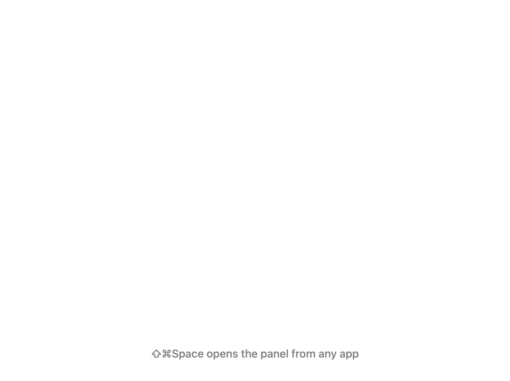

# Quick Access for Bitwarden

A macOS menu bar app that opens a Spotlight-style panel on a global shortcut to search a Bitwarden
vault and copy usernames, passwords, one-time codes and other fields, without switching to the
Bitwarden app.

<picture>
  <source media="(prefers-color-scheme: dark)" srcset="docs/screencast-dark.gif">
  
</picture>

It is a companion to the official Bitwarden desktop app, not a Bitwarden client of its own. It is
an independent project, not affiliated with, endorsed by or sponsored by Bitwarden, Inc.

## How it works

- **Unlock.** The app asks the running Bitwarden desktop app to unlock, over the local IPC the
  Bitwarden browser extension uses. The desktop app shows its own Touch ID prompt and hands over
  the vault key. The app never sees the master password and stores no key anywhere.
- **Vault.** Items come from the desktop app's local state file, which holds the account that is
  active in the desktop app, and are decrypted in memory with Apple's CommonCrypto, CryptoKit and
  Security frameworks. Secret values stay encrypted until the moment they are copied.
- **Settings.** The app follows the desktop app's settings instead of having its own:

  | Bitwarden desktop setting      | Effect here                                                      |
  | ------------------------------ | ---------------------------------------------------------------- |
  | Vault timeout                  | When the app forgets the vault key (idle, sleep, screen lock, …) |
  | Clear clipboard                | When a copied value is removed from the clipboard                |
  | Unlock with Touch ID           | Must be on; it is the only way to unlock                         |
  | Show website icons             | Whether icons are fetched, from the account's icon service       |
  | Language                       | The language of the panel, where it is English, Slovak or Czech  |
  | Master password re-prompt      | Only username and website of such items can be copied            |
  | "View password" off (shared)   | Password, one-time code and hidden fields are not offered        |

There is no login and no synchronization: what the desktop app has synced is what the panel shows.
The only network requests fetch website icons, as described under Security notes.

## Requirements

- macOS 15 or later (the deployment target; developed and tested on macOS 27).
- Xcode with Swift 6 or later to build (developed with Xcode 27.2).
- The Bitwarden desktop app, running and logged in, with **Unlock with Touch ID** switched on
  in its settings. Developed against version 2026.10.4.
- An account with Bitwarden's classic encryption (see Limitations).

## Install

With [Homebrew](https://brew.sh):

```sh
brew install --cask lifo9/tap/quick-access-for-bitwarden
```

Or download the disk image from the
[Releases page](https://github.com/lifo9/quick-access-for-bitwarden/releases), open it and drag
the app to Applications. Both are the same build: signed with a Developer ID certificate and
notarized by Apple, for Apple silicon Macs.

To build from source instead:

```sh
just install    # builds, copies the app to /Applications and starts it
```

Without `just`: `scripts/bundle-app.sh` builds `build/Quick Access for Bitwarden.app`; copy it to
`/Applications` and open it. A build from source is signed ad hoc, which runs on the Mac that
built it.

"Launch at Login" is in the menu of the menu bar icon.

## Use

**⇧⌘Space** opens and closes the panel from any app.

| Key        | Action                                                      |
| ---------- | ----------------------------------------------------------- |
| ↑ ↓        | Move the selection                                          |
| ↩          | Copy the password (card number, note) and close             |
| ⌘C         | Copy the username, or the main field of other item kinds    |
| ⇧⌘C        | Copy the password                                           |
| ⌥⌘C        | Copy the current one-time code                              |
| ⌥↩         | Open the item's website in the browser                      |
| →          | Show everything that can be done with the selected item     |
| ←          | Back to the list                                            |
| Esc        | Back, then clear the search, then close                     |

Before anything is typed, the list suggests items named after the app in front, then the items
used most often, then favorites.

Drag the panel by any empty part of it to move it, and by its edges to resize it; it comes back
where and how it was left. It is an ordinary window, so window managers can place it too. It
follows the light or dark appearance of the Mac.

The panel is in English, Slovak or Czech: in the language the Bitwarden desktop app is set to,
or the Mac's first language when Bitwarden follows the system.

The menu bar icon can be hidden from its menu, or dragged out of the menu bar with the Command
key held. Opening the app again, from Spotlight or the Applications folder, brings it back.

On macOS versions where the system uses ⇧⌘Space itself ("Ask Siri about active window"), switch
that shortcut off under System Settings → Keyboard → Keyboard Shortcuts.

## Limitations

- **Depends on internals of the Bitwarden desktop app.** Neither the state file nor the IPC is a
  public interface. A desktop app update can break unlocking or reading until this app is adapted;
  it then fails with a message rather than showing wrong data. `just diagnose` reports which part
  stopped working. See [docs/desktop-integration.md](docs/desktop-integration.md).
- **Classic encryption only.** Accounts or items in Bitwarden's newer encryption formats are
  refused: the app reports unsupported items instead of guessing.
- Only the account active in the desktop app. No attachments, passkeys, Sends, editing or autofill.

## Security notes

- The vault key and decrypted values live only in this process's memory and are dropped on lock
  and on quit. Nothing secret is written to disk; the preferences hold item ids with use counts
  and a random client id.
- Copied secrets carry the marker that tells clipboard managers not to record them, and are
  removed after the desktop app's clear-clipboard delay if they are still on the clipboard.
- Website icons are the only network traffic. Like the Bitwarden apps, the app asks the icon
  service of the account's server (the self-hosted server, or Bitwarden's cloud) for the icon of
  a login's host name, only for items that are on screen and only while "Show website icons" is
  on in the desktop app. Icons are kept in memory, not on disk, and forgotten on lock.
- The desktop app's IPC does not authenticate its clients: any process of the same user can ask
  for a Touch ID unlock. This app does not widen that; it is one more such client.

## Development

`just check` checks the format, builds everything and runs the tests; CI runs the same commands
on every push and pull request. `just demo` runs the app against an invented vault, without the
Bitwarden desktop app or Touch ID, and `just screencast` records the animation above from it. See [AGENTS.md](AGENTS.md) for the layout and the rules, and
[docs/releasing.md](docs/releasing.md) for how a release is cut.

## License

[MIT](LICENSE.md).

Bitwarden is a trademark of Bitwarden, Inc. It is used here only to name the software this
project works with.
